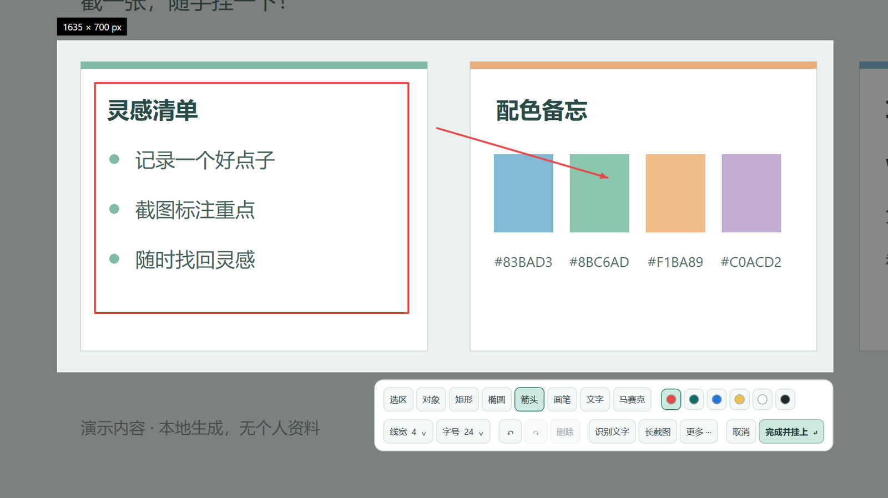
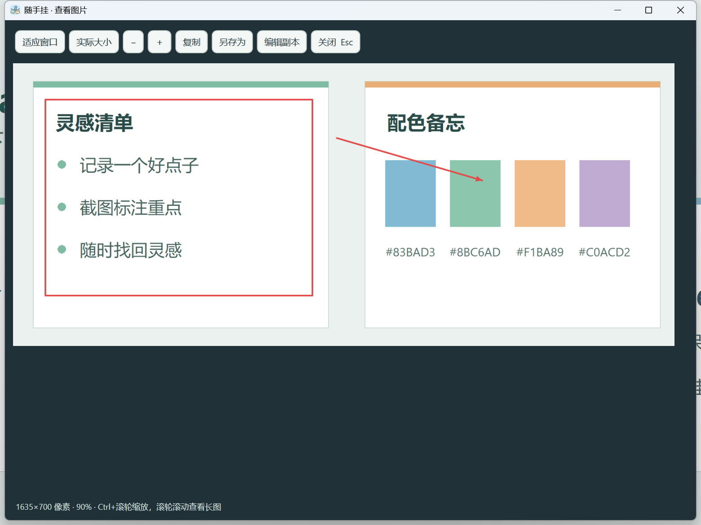
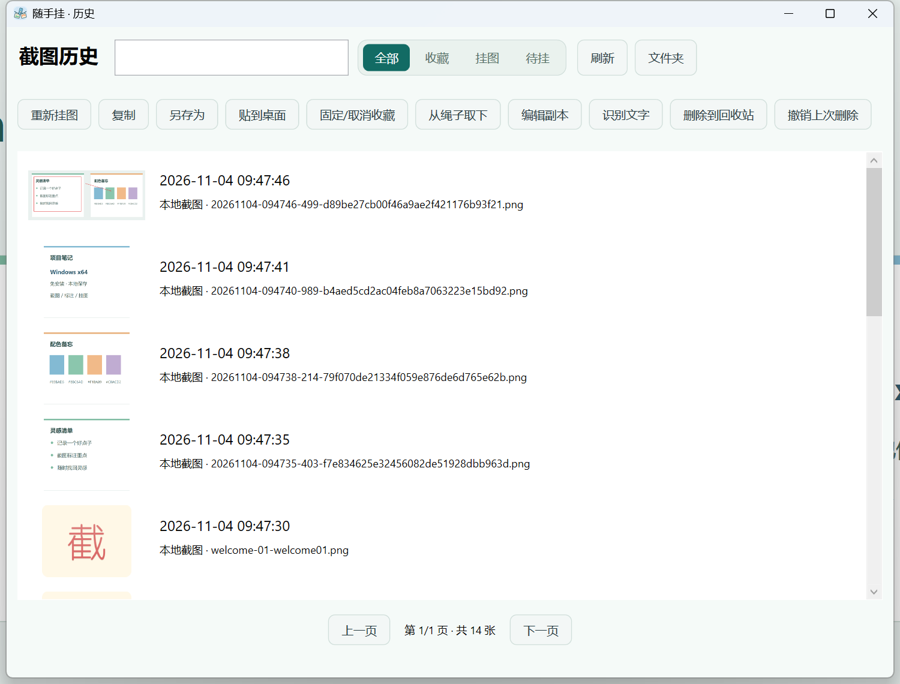
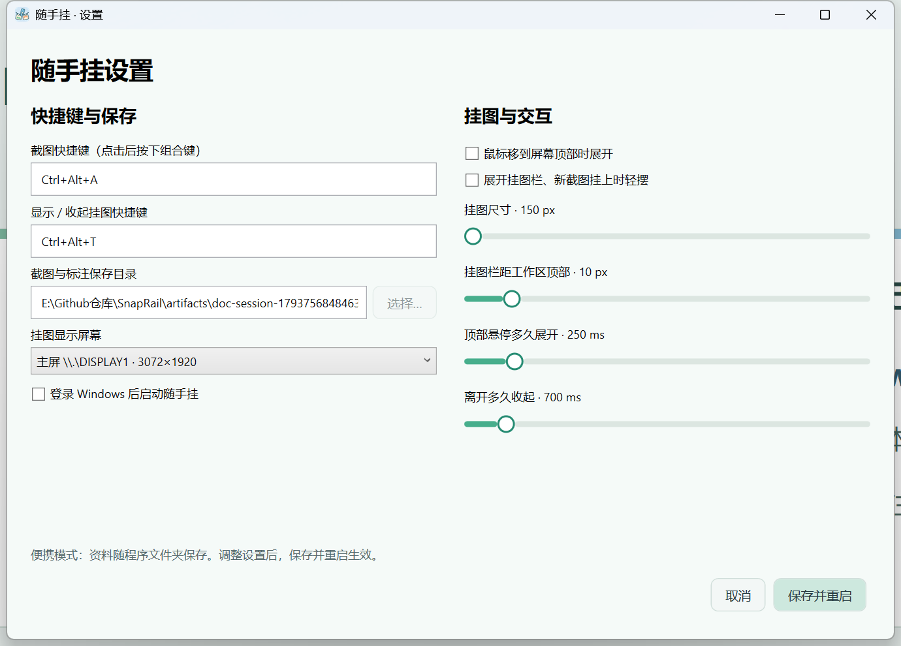

# SnapRail · 随手挂 — Windows

[简体中文](README_WINDOWS.md) | [English](README_WINDOWS.en.md)

**Windows 1.0.0 正式版 · x64 · 免安装 · MIT 开源**

Windows 专用使用、数据目录与构建说明。跨平台入口见 [项目首页](README.md)，Mac 用户请阅读 [macOS 说明](README_MACOS.md)。本页截图均为 Windows 界面。

## 下载与快速开始

在本仓库的 **Releases** 页面下载 `SnapRail-v1.0.0-Portable-win-x64.zip`，完整解压到可写文件夹，双击 `SnapRail.exe` 即可运行。**无需安装，也无需另装 .NET。**

1. 按 **Ctrl+Alt+A**，拖动框选区域，或单击选择窗口。
2. 需要标注时，选择矩形、箭头、文字等工具。
3. 按 **Enter** 或点击“完成并挂上”。图片自动保存、复制并挂到绳子上。
4. 按 **Ctrl+Alt+T** 展开/收起；也可将鼠标停在屏幕顶部中央。
5. 单击挂图复制，双击查看大图，沿绳子拖动整理顺序。

关闭挂图栏不等于退出程序。退出请使用 Windows 托盘中的“随手挂”菜单。

| 发布文件 | 用途 |
| --- | --- |
| `SnapRail-v1.0.0-Portable-win-x64.zip` | 普通用户下载，解压即用 |
| `SnapRail-v1.0.0-source-windows-macos.zip` | Windows 与 macOS 完整源码、中英文说明和开发脚本 |
| `SHA256SUMS.txt` | 下载完整性校验 |

## 平台与系统

- **1.0 正式版面向 Windows x64 桌面环境。** macOS 说明见本页顶部链接。
- 主要在 Windows 11 x64 实测；Windows 10 x64 兼容性尚未完整验证。
- 使用自包含 .NET 运行时，便携版无需安装开发环境。
- 支持多显示器、负坐标和不同缩放比例，实测主屏 150%、副屏 125%。
- 从可写目录运行，保留 EXE 旁的 `SnapRail.portable` 文件。

## 截图与标注

支持区域框选、窗口选择、全屏及跨屏截图。框选后可拖动边缘和手柄调整范围，方向键微调。

提供 **矩形、椭圆、箭头、画笔、文字、马赛克** 六种标注。“对象”工具可以选中已有标注并移动、改色、调整线宽或删除；双击文字可以修改。支持中文多行文字、撤销和重做。



“更多”中可以另存为和选择全屏。重新编辑截图会保存为新挂图，保留原版本与可编辑资料。

## 桌面晾衣绳

弯曲绳子、卡通夹子和小挂图铺满当前屏幕，两侧保留边距。超过可见数量时，右侧以 **＋** 进入历史，无横向滚动条。


| 操作 | 效果 |
| --- | --- |
| 单击挂图 | 复制完整图片到剪贴板 |
| 双击挂图 | 打开图片预览 |
| 按住并沿绳拖动 | 挂图抬起、邻图让位，松手保存顺序 |
| 拖动中按 Esc | 取消本次排序 |
| 向其他应用拖出 | 导出独立 PNG 副本，保留原图 |
| 点击夹子 | 取下为桌面置顶贴图 |
| 右键 → 固定收藏 | 收藏并自动靠左排序 |

收藏最多 **3 张**，使用金色星章夹和“收藏”文字提示；超过上限会轻晃提醒。开启动画后，新图片挂上和展开时会轻摆一次。

## 图片预览与置顶贴图

预览支持适应窗口、100% 实际大小、缩放和长图滚动，按 Esc 关闭。



置顶贴图可拖动上沿移动、滚轮缩放、Ctrl+滚轮调整透明度；关闭或选择“挂回”返回绳子。收藏、排序和贴图位置保存在本地。

## 截图历史

按日期、时间或文件名搜索，通过“全部 / 收藏 / 挂图 / 待挂”筛选，每页 24 张。支持 Ctrl 多选、Shift 连续选择。



支持重新挂图、复制、另存为、贴到桌面、固定收藏、从绳子取下、编辑副本、识别文字、删除到回收站、撤销上次删除。

**从绳子取下只隐藏挂图。** 删除同时处理图片、原图和标注；清空系统回收站后无法保证恢复。

## 滚动长截图

1. 按 Ctrl+Alt+A 框选可滚动正文，尽量避开固定导航栏和悬浮元素。
2. 点击“长截图”。
3. 选择自动向下滚动，或手动滚动后追加当前画面；相邻画面需有重叠。
4. 停止后点击“预览并编辑”，检查拼接，确认后保存并挂图。

画面不变、匹配不可靠或达到限制时会停止。上限为 80 帧、30000 像素高或 5000 万像素。动画、重复纹理和固定栏可能影响拼接，请检查结果。

## 本机文字识别（OCR）

在截图工具栏或历史中点击“识别文字”，使用本机 Windows OCR，结果可以修改后复制。

依赖 Windows 对应语言组件，缺少时会提示。长边超过 4000 像素的图片会缩小识别，小字和中文标点需要校对。

## 设置

两栏页面可调整截图/展开快捷键、显示屏、挂图大小、顶部位置、展开/收起延迟、动画和开机启动。



保存后程序重启生效。快捷键被其他应用占用时会提示，保存新绑定失败时保留原绑定。

## 常用快捷键

| 场景 | 快捷键 | 功能 |
| --- | --- | --- |
| 桌面 | Ctrl+Alt+A | 截图，可在设置中修改 |
| 桌面 | Ctrl+Alt+T | 展开/收起，可在设置中修改 |
| 截图 | Enter | 完成并挂上 |
| 截图 | Esc / 右键 | 放弃当前操作或取消截图 |
| 截图 | Ctrl+A | 选择鼠标所在屏幕 |
| 编辑 | Ctrl+Z | 撤销 |
| 编辑 | Ctrl+Y / Ctrl+Shift+Z | 重做 |
| 编辑 | Ctrl+S | 另存为 |
| 文字输入 | Enter / Ctrl+Enter | 换行 / 完成文字输入 |
| 对象选中 | Delete / 方向键 | 删除 / 微调 |
| 图片预览 | Esc | 关闭预览 |

## 便携数据与升级

所有日常数据保存在便携程序文件夹中：

```text
SnapRail-Portable/
├─ SnapRail.exe             程序
├─ SnapRail.portable        便携标记，请保留
├─ images/                  已保存的截图
├─ documents/               原图和可编辑标注
├─ settings.json            使用后生成的设置
├─ library.json             使用后生成的历史、收藏与排序
├─ 使用说明.md
├─ LICENSE
└─ THIRD-PARTY-NOTICES.txt
```

下载包 **不带开发者截图、历史、配置或测试数据**。空资料库首次启动时，会自动在 images 生成“截一张，随手挂一下！”共 10 张欢迎 PNG，可在历史中删除，删除后不会自动补回。

移动前从托盘退出，再复制整个文件夹。升级前备份旧文件夹，替换 EXE，保留自己的 images、documents 和配置。移动路径后如需开机启动，请重新保存该设置。

## 隐私与已知限制

截图保存在本机，OCR 使用本机 Windows 组件，没有账号、云同步或截图上传功能。按用户操作复制或拖出时，会交给剪贴板和目标应用处理。

程序尚未代码签名。Windows 10、HDR、独占全屏、受保护内容、真实显示器热插拔/睡眠唤醒和不同聊天软件仍有未覆盖场景。OCR 可能错字，滚动拼接可能失败，请检查输出。

文中图片均来自实际 1.0.0 Windows 界面，底图为专门创建的演示内容。

## 问题反馈

请通过 GitHub Issues 提交问题，包含版本号、Windows 版本、显示器数量/缩放比例、复现步骤、预期和实际结果。分享截图或日志前，请检查是否含自己的资料。

## 开发与构建

Windows + .NET SDK **10.0.403**，WPF / Win32，无第三方 NuGet 包依赖。

```powershell
.\scripts\setup.ps1          # 缺少 SDK 时执行
.\scripts\build.ps1
.\scripts\test.ps1
.\scripts\package.ps1 -IncludeSource
.\scripts\run.ps1
```

发布目录：`release/SnapRail-v1.0.0`。白名单打包，不包含运行数据、编译缓存或旧发布包。测试代码与脚本属于源码的一部分。

[完整使用说明](docs/USER_GUIDE.md) · [开发说明](docs/DEVELOPMENT.md) · [发布说明](docs/RELEASE_NOTES.md) · [验收记录](docs/RELEASE_VERIFICATION.md) · [更新记录](CHANGELOG.md)

## 许可证与致谢

代码使用 [MIT 许可证](LICENSE)。.NET 运行时声明见便携包 THIRD-PARTY-NOTICES.txt。

创意参考 [PicRope](https://github.com/Renly1994/PicRope) 与 [Snipaste](https://www.snipaste.com/) 的交互，独立实现。欢迎文字使用 Windows 系统字体，不分发系统字体文件。
